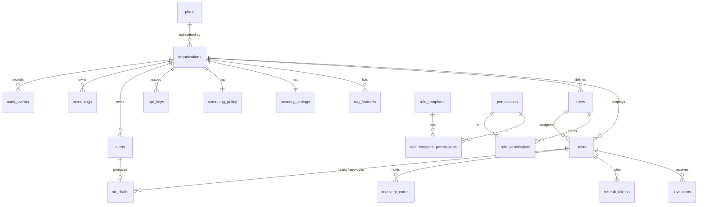

# Database

PostgreSQL 16. Two databases on one server: `sentrail` (this app) and `keycloak` (the identity
provider's own tables, managed by Keycloak). Full column list: [schema-tables.md](schema-tables.md). Roles and permissions: [ROLES.md](ROLES.md).

## Roles and connections

| Role | Login | Used by | Can |
|---|---|---|---|
| `postgres` | yes | operators only | Superuser. Bootstrap and emergencies. Never used by the app |
| `sentrail_owner` | yes | `backend/scripts/migrate.py` | Owns the schema. Row-level security still applies to it (`FORCE`) |
| `sentrail_app` | yes | the API (`DATABASE_URL`) | Read and write tenant data, always filtered by row-level security. Can't change or delete audit events |
| `sentrail_auth` | no | sign-in lookup functions | Bypasses row-level security but can read only the columns the lookups need |
| `keycloak` | yes | Keycloak (`KC_DB_*`) | Owns the `keycloak` database only |

```
API ──────── postgresql://sentrail_app:…@postgres:5432/sentrail?sslmode=verify-full
migrate.py ─ postgresql://sentrail_owner:…@postgres:5432/sentrail
Keycloak ─── jdbc:postgresql://postgres:5432/keycloak  (user keycloak)
```

The API uses a connection pool (`backend/app/pg.py`, 2 to 20 connections). Every request runs in a
transaction that sets `app.org_id` (or `app.platform`) with `SET LOCAL`, which resets at commit, so a
pooled connection never carries one tenant's context into another request. Put PgBouncer in
transaction mode in front if you run many API replicas.

## Entity relationships



## Tables at a glance

| Group | Table | Holds | Personal data |
|---|---|---|---|
| Tenancy | `organizations` | Legal name, registration, plan, environment, brand colour, SSO domain | No |
| | `org_features` | Features in the plan and switched on | No |
| | `security_settings` | MFA, timeout, password length, IP allowlist, retention | No |
| Access | `permissions` | 19 permission keys, each tagged `platform` or `tenant` | No |
| | `role_templates`, `role_template_permissions` | Seed data: default roles for each login type ([ROLES.md](ROLES.md)) | No |
| Platform | `plans` | Starter, Professional, Enterprise and their features | No |
| | `platform_settings` | Security baseline every tenant must meet | No |
| | `roles`, `role_permissions` | System and custom roles per organization | No |
| Identity | `users` | Role, status, Keycloak subject, lockout, session version | Email, name, phone, TOTP secret: **encrypted** |
| | `invitations` | Hashed single-use tokens (local mode) | No |
| | `refresh_tokens` | Hashed session tokens, device, IP, sign-in method | IP address |
| | `recovery_codes` | argon2id-hashed codes | No |
| | `oidc_login_states` | State, nonce and PKCE verifier for 10 minutes | No |
| | `api_keys` | Hashed ramp keys and scopes | No |
| Compliance | `alerts` | Score, band, reasons, status | Customer IDs |
| | `str_drafts` | AI draft and final STR, drafter, approver | STR text: **encrypted** |
| | `screenings` | Every screened transfer and decision | Wallet addresses |
| | `screening_policy` | Hold and block thresholds | No |
| Audit | `audit_events` | Hash-chained, append-only log | Actor IDs, IP |
| Ops | `schema_migrations` | Applied migrations with checksums | No |

## Migrations

`backend/migrations/*.sql` are applied in order by `python -m scripts.migrate`, once each, inside a
transaction. A migration that changed after it was applied is refused; write a new one instead.

| File | What it does |
|---|---|
| `001_init.sql` | Core schema, row-level security on tenant tables, append-only audit trigger, lookup functions |
| `002_seed_roles.sql` | Platform admin role |
| `003_identity_provider.sql` | Keycloak subject, tenant display fields, SSO domains, login state, session details, row-level security on `organizations` |
| `004_lookup_role.sql` | Moves sign-in lookups to the least-privilege `sentrail_auth` role |
| `005_platform_console.sql` | Permission scopes (platform vs organization) with a trigger that rejects mixing them; role templates seeded per login type; four platform roles; plans; platform security baseline enforced on every tenant by trigger; two-step verification forced on |
| `006_review_fixes.sql` | Alert status CHECK and link to its screening; screening idempotency key, fiat value, stored answer and override details; API key label and timestamps; `login_throttle` for per-(email, IP) lockout |

## Fresh install

```bash
docker compose up -d postgres          # infra/postgres/init creates databases and roles
docker compose run --rm migrate        # applies migrations, sets the app role password
docker compose run --rm api python -m scripts.seed          # master login
docker compose run --rm api python -m scripts.seed --demo          # optional demo tenants (refused when ENV=production)
```
