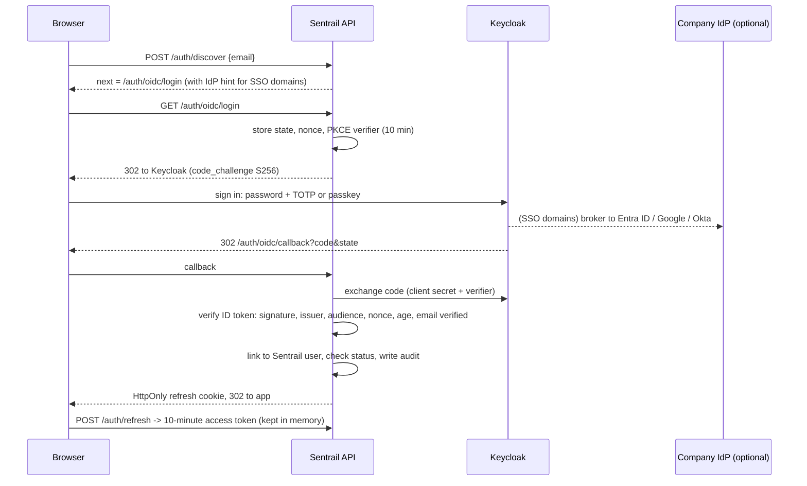

# Identity and sign-in

Sentrail uses **Keycloak** (open source, CNCF incubating project) as its identity provider over
OpenID Connect. Keycloak proves *who* someone is. Sentrail decides *what they can do*: roles,
permissions and tenants live in Sentrail's own database.

## Sign-in flow (backend-for-frontend)

The browser never sees Keycloak's tokens. Sentrail issues its own short sessions, so suspending a
user or changing their role takes effect on their next request.

## Two login types, one sign-in page

Everyone uses the same page: email, then whatever their account needs (company SSO, or password then
passkey or code). The email decides where they land:

| Login type | Lands in | Roles | Can see customer data |
|---|---|---|---|
| Platform (Sentrail staff, `org_id` empty) | Platform console | Platform owner, admin, support, auditor | Never. Enforced by a database trigger on role permissions |
| Organization (customers) | Their organization, shown under the app name | Organization admin, compliance officer, analyst, auditor, plus custom roles | Only their own organization's, through row-level security |

The roles for each type are seed data in the database; see [ROLES.md](ROLES.md).

## Who signs in how

| Person | How |
|---|---|
| Employee at an organization with a verified SSO domain | Their company IdP, brokered by Keycloak. Linked to their Sentrail account on first sign-in, only if the email is on that verified domain |
| Anyone else (external auditors, smaller organizations) | Keycloak password + TOTP or passkey. Keycloak emails a single-use setup link when they're invited |
| Platform master login | Local break-glass account (password + TOTP), works even if Keycloak is down. Organization users can't use local sign-in in Keycloak mode |

Accounts are never created on sign-in. An admin must invite each person first.

## Keycloak realm (`infra/keycloak/realm-sentrail.json`)

Imported on first start. It sets brute-force protection (5 failures), a 14-character password
policy with history, TOTP, passkeys (WebAuthn with user verification), 15-minute idle and 12-hour
maximum sessions, event logging, no self-registration, and two clients:

- `sentrail-web`: confidential client for sign-in, authorization code + PKCE only (no implicit or password grants).
- `sentrail-admin`: service account limited to `manage-users`, `view-users`, `query-users`, used to invite, disable and reset users.

Only the email address goes to Keycloak. Names and all compliance data stay encrypted in Sentrail.

**Two-factor is required for every Keycloak user** (Keycloak's own policy; the choose-it-yourself model below applies to local sign-in). (The per-organization "optional two-factor" setting applies to
Sentrail's own password sign-in, `AUTH_MODE=local` and the break-glass login; Keycloak enforces its own realm policy.)
Invited users get the `CONFIGURE_TOTP` required action
and can add a passkey. Because of this, `TRUST_IDP_MFA=true` by default. If you can't guarantee it
(for example a brokered IdP that doesn't enforce MFA), set it to `false` and configure an `amr` or
`acr` claim in Keycloak that proves MFA; Sentrail then rejects sign-ins without it.

## Adding a company's own IdP

1. In Keycloak, add an identity provider (OIDC or SAML) with an alias, such as `northwind-entra`.
   Set its first-broker-login flow to not create accounts automatically.
2. In Sentrail, the org admin calls `PUT /admin/sso` with the domain and alias, adds the returned TXT
   record at `_sentrail.<domain>`, then calls `POST /admin/sso/verify`.
3. From then on, emails on that domain go straight to the company IdP.

## Check after upgrading Keycloak

Realm import fields change between Keycloak versions. After a first start, confirm in the Keycloak
console that brute-force protection, the password policy, OTP policy and both clients match the
file. The compose file pins Keycloak 26.0; update the tag deliberately.
